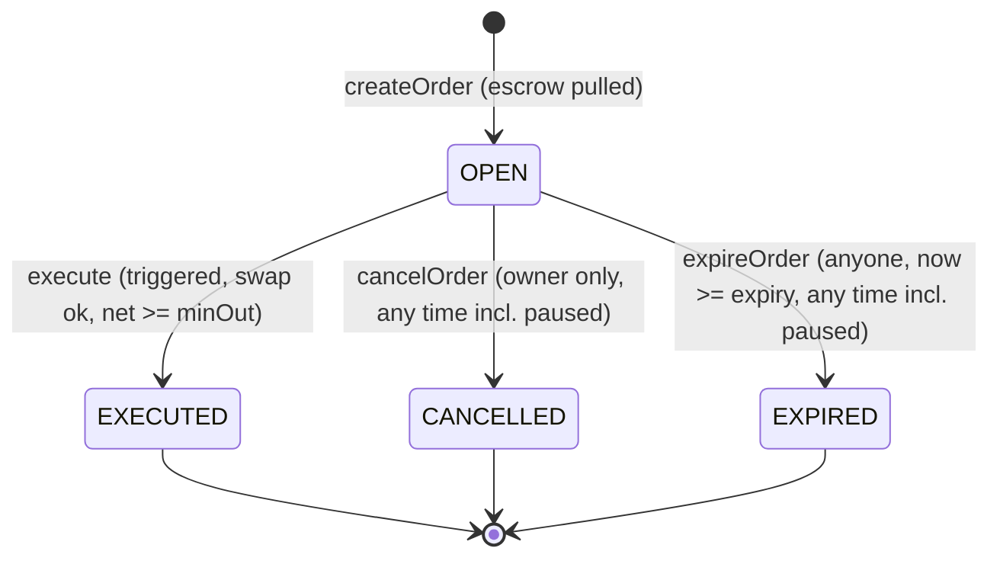
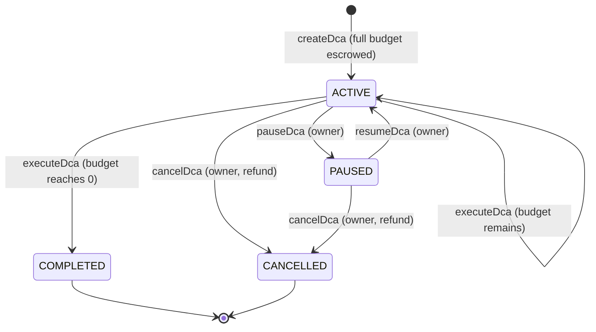

# ArcTradeOrders — Contract Reference

Source: `contracts/ArcTradeOrders.sol` (Solidity `^0.8.20`, compiled with 0.8.28 / Cancun, optimizer 200 runs; OpenZeppelin Contracts 5.x).

This document describes the contract exactly as implemented. Companion documents:

- [`order-types.md`](./order-types.md): per-order-type behaviour and worked examples
- [`security.md`](./security.md): trust model, threat model, audit history, limitations

---

## 1. Overview

`ArcTradeOrders` is an escrow-backed conditional-order and dollar-cost-averaging (DCA) contract.

- A user deposits (escrows) a token amount and specifies a trigger condition (limit, stop-loss, take-profit, stop-limit, trailing stop, OCO) or a recurring purchase schedule (DCA).
- When the trigger condition is met according to a Chainlink-compatible price oracle, **anyone** (a "keeper") may execute the order by supplying a swap `target` (an owner-allowlisted contract) and arbitrary calldata for it.
- The contract never trusts the keeper's calldata. It only checks the *outcome*: exactly `amountIn` of the input token left the contract, the output token balance grew, and the output, net of the keeper fee, is at least a minimum computed from the oracle (and, for some order types, the user's own price).
- The keeper is paid a fee in basis points of the swap **output**, in the output token.
- There is a single immutable **quote token** (e.g. USDC). Every order or DCA plan trades the quote token against one **base token**.
  - `BUY` orders spend quote and receive base.
  - `SELL` orders spend base and receive quote.
  - DCA plans always spend quote and receive base.
- There is no native-token handling, no standing token allowance, no rescue function and no owner withdrawal path. Escrow can only leave through execution (to the order owner and the keeper), cancellation or expiry (to the order owner), or DCA cancellation (to the plan owner).
- The contract is **not upgradeable** (no proxy, no `delegatecall`).

Inheritance: `Ownable2Step` (which extends `Ownable`), `Pausable`, `ReentrancyGuard`. All state-changing external functions are `nonReentrant`.

---

## 2. Roles

| Role | Who | Powers | Cannot |
|---|---|---|---|
| **Owner** | `owner()`; set in the constructor; transferred with the two-step `transferOwnership` / `acceptOwnership` | Queue, apply and cancel timelocked config (token feeds, swap targets); instantly disable a token feed or a swap target; lower (never raise) the keeper fee; pause / unpause; transfer or renounce ownership | Withdraw escrow; change an existing order's terms; raise the keeper fee; bypass the timelock to *add* a feed or swap target; block cancellations, expiries, or DCA cancellations |
| **Keepers** | Any address. There is no keeper registry or privileged role. | Call `execute`, `executeDca`, `activateStop`, `pokeTrailing`, `expireOrder`. `execute` / `executeDca` pay the caller the keeper fee. | Direct output to themselves (output must arrive in the contract and is paid to the order owner), spend more or less than `amountIn`, use a non-allowlisted target |
| **Order owners** | The `msg.sender` of `createOrder` / `createDca` | Cancel their own open order; pause / resume / cancel their own DCA plan | Modify an order after creation; act on other users' orders |
| **Anyone** | Any address | Read views; call `expireOrder` (refund always goes to the order owner), `pokeTrailing`, `activateStop` | |

Note: `renounceOwnership()` inherited from `Ownable` is not disabled. See [`security.md`](./security.md) for the consequences.

---

## 3. Constants, immutables and state variables

### 3.1 Constants (private)

| Name | Value | Meaning |
|---|---|---|
| `BPS` | `10_000` | Basis-point denominator for slippage, fee and trailing percentages |
| `WAD` | `1e18` | Fixed-point scale for all prices (`price18`) |
| `MAX_USER_PRICE` | `type(uint128).max` | Upper bound for user-supplied `triggerPrice`, `limitPrice` and DCA `maxPrice` |

Hard-coded limits used inline in code:

| Limit | Where | Value |
|---|---|---|
| Config delay | constructor | `1 hours ≤ configDelay_ ≤ 14 days` |
| Feed `maxStaleness` | `queueTokenConfig` / `_setToken` | `60 ≤ maxStaleness ≤ 172800` seconds (48 h) |
| Token decimals | `_setToken` | `tokenDecimals ≤ 59` |
| Feed decimals | `_setToken` | `feedDecimals ≤ 77` |
| Order slippage | `_validateSlippage` | `1 ≤ maxSlippageBps ≤ 1000` (0.01% – 10%) |
| Trailing trail | `_validateOrderPrices` | `10 ≤ trailBps ≤ 5000` (0.10% – 50%) |
| DCA buys | `createDca` | `1 ≤ numBuys ≤ 520` |
| DCA interval | `createDca` | `interval ≥ 3600` seconds |

### 3.2 Immutables and public state

| Name | Type | Visibility | Meaning |
|---|---|---|---|
| `quote` | `address immutable` | public | The quote ERC-20 token. Set once in the constructor. |
| `configDelay` | `uint32 immutable` | public | Seconds between queueing and the earliest apply of a config change. |
| `keeperFeeBps` | `uint16` | public | Keeper fee on swap output, in bps. Initial value `10` (0.10%). Can only be lowered. |
| `nextOrderId` | `uint256` | public | Next order id; starts at `1`. |
| `nextDcaId` | `uint256` | public | Next DCA plan id; starts at `1`. |
| `tokenConfigs` | `mapping(address => TokenConfig)` | public | Feed and decimals metadata per token (quote and bases). |
| `swapTargets` | `mapping(address => bool)` | public | Allowlist of swap target contracts. |

### 3.3 Private storage

| Name | Type | Meaning |
|---|---|---|
| `_configNonce` | `uint256` | Monotonic counter mixed into every `changeId` so identical requests produce distinct ids. |
| `_pendingConfigs` | `mapping(bytes32 => PendingConfig)` | Queued config changes. Only the ETA is readable on-chain (`pendingConfigEta`). |
| `_orders` | `mapping(uint256 => Order)` | Orders by id. |
| `_orderIds` | `mapping(address => uint256[])` | Order ids per creator (append-only). |
| `_dcas` | `mapping(uint256 => Dca)` | DCA plans by id. |
| `_dcaIds` | `mapping(address => uint256[])` | DCA ids per creator (append-only). |

Inherited state: `owner()`, `pendingOwner()` (Ownable2Step), `paused()` (Pausable), reentrancy status (ReentrancyGuard).

---

## 4. Types

### 4.1 Interfaces

- `AggregatorV3Interface` — minimal Chainlink-compatible surface: `decimals()` and `latestRoundData()`.
- `IArcTradeErrors` — contains only `error OrderExpired(uint256 id)`. It lives in a separate interface so the custom error and the lifecycle event `OrderExpired` can share a name. The contract reverts with `IArcTradeErrors.OrderExpired(id)`; the selector is `bytes4(keccak256("OrderExpired(uint256)"))`.

### 4.2 Enums

| Enum | Values (in order) |
|---|---|
| `Side` | `BUY` (0), `SELL` (1) |
| `OrderType` | `LIMIT` (0), `STOP_LOSS` (1), `TAKE_PROFIT` (2), `STOP_LIMIT` (3), `TRAILING_STOP` (4), `OCO` (5) |
| `Status` | `OPEN` (0), `EXECUTED` (1), `CANCELLED` (2), `EXPIRED` (3) |
| `DcaStatus` | `ACTIVE` (0), `PAUSED` (1), `CANCELLED` (2), `COMPLETED` (3) |

### 4.3 Structs

**`TokenConfig`** (stored in `tokenConfigs`)

| Field | Type | Meaning |
|---|---|---|
| `feed` | `address` | Chainlink-compatible USD feed. `address(0)` means the token is disabled / unsupported for pricing. |
| `feedDecimals` | `uint8` | Cached `feed.decimals()` at apply time. |
| `tokenDecimals` | `uint8` | Cached `token.decimals()` at apply time. |
| `maxStaleness` | `uint32` | Maximum accepted age of the feed's `updatedAt`, in seconds. |

**`PendingConfig`** (stored in `_pendingConfigs`)

| Field | Type | Meaning |
|---|---|---|
| `subject` | `address` | Token (if `isToken`) or swap target. |
| `feed` | `address` | New feed (token changes only; zero disables). |
| `maxStaleness` | `uint32` | New staleness bound (token changes only). |
| `isToken` | `bool` | `true` = token feed change; `false` = swap-target change. |
| `allowed` | `bool` | Desired allowlist state (swap-target changes only). |
| `eta` | `uint256` | Earliest apply timestamp (`queue time + configDelay`). Zero means "no such entry". |

**`CreateParams`** (argument of `createOrder`, echoed in `OrderCreated`)

| Field | Type | Meaning |
|---|---|---|
| `base` | `address` | Base token traded against `quote`. |
| `side` | `Side` | `BUY` or `SELL` the base token. |
| `orderType` | `OrderType` | Order kind. |
| `amountIn` | `uint256` | Exact input escrowed: quote units for `BUY`, base units for `SELL`. |
| `triggerPrice` | `uint256` | Main trigger, quote per whole base, 1e18 scale. Lower leg for OCO. Zero for trailing. |
| `limitPrice` | `uint256` | Stop-limit: minimum acceptable price. OCO: upper (take-profit) trigger. Zero otherwise. |
| `trailBps` | `uint16` | Trailing distance in bps (trailing stop only; zero otherwise). |
| `maxSlippageBps` | `uint16` | Allowed deviation from the oracle-implied output, `1..1000`. |
| `expiry` | `uint40` | Unix timestamp; the order can no longer execute at or after it. |

**`Order`** (returned by `getOrder`)

| Field | Type | Meaning |
|---|---|---|
| `owner` | `address` | Creator; receives output and refunds. |
| `side`, `orderType` | enums | As in `CreateParams`. |
| `status` | `Status` | Lifecycle state. |
| `expiry` | `uint40` | As created. |
| `stopActivated` | `bool` | Stop-limit only: latched `true` once the stop condition has been persisted. |
| `base` | `address` | Base token. |
| `trailBps` | `uint16` | As created. |
| `maxSlippageBps` | `uint16` | As created. |
| `createdAt` | `uint40` | Creation timestamp. |
| `executedAt` | `uint40` | Execution timestamp (0 until executed). |
| `amountIn` | `uint256` | Escrowed input. |
| `triggerPrice`, `limitPrice` | `uint256` | As created. |
| `peakPrice` | `uint256` | Trailing only: highest persisted price (initialised to the creation price; 0 for other types). |
| `amountOut` | `uint256` | Net amount paid to the owner at execution (after keeper fee). |
| `executionPrice` | `uint256` | Realized price from net proceeds, quote per whole base, 1e18 scale. |

**`Dca`** (returned by `getDca`)

| Field | Type | Meaning |
|---|---|---|
| `owner` | `address` | Creator; receives purchased base and refunds. |
| `status` | `DcaStatus` | Lifecycle state. |
| `nextExecution` | `uint40` | Earliest timestamp of the next buy. |
| `interval` | `uint32` | Seconds between buys (≥ 3600). |
| `base` | `address` | Base token being bought. |
| `maxSlippageBps` | `uint16` | Slippage tolerance versus the oracle price, `1..1000`. |
| `executions` | `uint16` | Number of completed buys. |
| `createdAt` | `uint40` | Creation timestamp. |
| `amountPerBuy` | `uint256` | Quote spent per buy. |
| `budgetRemaining` | `uint256` | Escrowed quote not yet spent. |
| `maxPrice` | `uint256` | Oracle price cap (quote per whole base, 1e18). `0` means no cap. |
| `totalSpent` | `uint256` | Cumulative quote spent. |
| `totalBought` | `uint256` | Cumulative net base delivered to the owner. |

---

## 5. Custom errors

| Error | Raised when |
|---|---|
| `ZeroAddress()` | A required address is zero (constructor `quote_`; config queue / disable inputs; `_setSwapTarget`). |
| `InvalidParameters()` | Generic validation failure: out-of-range numbers, wrong order shape, wrong order type for the call, a raise of the keeper fee, an invalid swap target (self or no code). |
| `UnsupportedDecimals()` | Token decimals > 59 or feed decimals > 77 at apply time. |
| `TokenNotSupported(address token)` | The token has no active feed (`feed == address(0)`). |
| `StalePrice(address token)` | Feed `updatedAt` is zero, in the future, or older than `maxStaleness`. |
| `InvalidPrice(address token)` | Feed call reverted, answer ≤ 0, scaling overflow, scaled price is 0, or the quote/base price ratio is 0; also `baseForQuote` with `price18 == 0`. |
| `InvalidOrder(uint256 id)` | Order id does not exist. |
| `OrderNotOpen(uint256 id)` | Order exists but is not `OPEN`. |
| `NotOrderOwner()` | `cancelOrder` called by someone other than the owner. |
| `NotTriggered()` | The trigger condition (or stop-activation condition) is not met. |
| `NotExpired()` | `expireOrder` called before `expiry`. |
| `SwapTargetNotAllowed(address target)` | The supplied target is not allowlisted. |
| `SwapFailed()` | The target call reverted with empty return data. (Non-empty revert data is bubbled up verbatim instead.) |
| `PartialFill(uint256 spent, uint256 required)` | Input spent ≠ `amountIn`. If the input balance *increased*, reports `PartialFill(0, amountIn)`. |
| `InvalidBalanceDelta()` | Output token balance decreased during the swap. |
| `TransferAmountMismatch()` | An escrow deposit changed the contract's balance by something other than the requested amount (fee-on-transfer / rebasing token). |
| `InsufficientOutput(uint256 net, uint256 minOut)` | Net output (after keeper fee) is below `minOut`, or net is zero (`InsufficientOutput(0, max(minOut, 1))`). |
| `InvalidDca(uint256 id)` | DCA id does not exist. |
| `DcaNotActive()` | The DCA plan is not `ACTIVE` (or has no budget left) for execute / pause. |
| `DcaNotPaused()` | `resumeDca` on a plan that is not `PAUSED`. |
| `DcaNotCancellable()` | `cancelDca` on a plan that is not `ACTIVE` or `PAUSED`. |
| `NotDcaOwner()` | A DCA owner-only call from a non-owner. |
| `DcaNotDue()` | `executeDca` before `nextExecution`. |
| `PriceAboveCap(uint256 price, uint256 cap)` | DCA oracle price exceeds `maxPrice`. |
| `TimestampOverflow()` | A timestamp does not fit in `uint40`. |
| `InvalidDelay()` | Constructor `configDelay_` outside `[1 hours, 14 days]`. |
| `ConfigNotReady()` | `applyConfig` before `eta`. |
| `ConfigUnknown()` | `applyConfig` / `cancelConfig` with an unknown or already-consumed id. |
| `IArcTradeErrors.OrderExpired(uint256 id)` | `execute` / `activateStop` / `pokeTrailing` at or after `expiry`. |

Errors inherited from OpenZeppelin that can surface: `OwnableUnauthorizedAccount(address)`, `OwnableInvalidOwner(address)` (zero owner at construction / transfer), `EnforcedPause()`, `ExpectedPause()`, `ReentrancyGuardReentrantCall()`, and `SafeERC20FailedOperation(address)` plus the token's own errors (e.g. insufficient allowance or balance) on failed transfers.

---

## 6. Events

| Event | Parameters (`indexed` marked) | Emitted by |
|---|---|---|
| `TokenConfigured` | `address indexed token, address indexed feed, uint8 feedDecimals, uint8 tokenDecimals, uint32 maxStaleness` | `applyConfig` (token change), `disableToken` |
| `SwapTargetSet` | `address indexed target, bool allowed` | `applyConfig` (target change), `disableSwapTarget` |
| `ConfigQueued` | `bytes32 indexed changeId, uint256 eta` | `queueTokenConfig`, `queueSwapTarget` |
| `ConfigCancelled` | `bytes32 indexed changeId` | `cancelConfig` |
| `StopActivated` | `uint256 indexed id, uint256 price` | `activateStop`; `execute` on a not-yet-activated stop-limit |
| `KeeperFeeSet` | `uint16 feeBps` | `setKeeperFeeBps` |
| `OrderCreated` | `uint256 indexed id, address indexed owner, address indexed base, CreateParams params, uint256 peakPrice, uint40 createdAt` | `createOrder` |
| `OrderExecuted` | `uint256 indexed id, address indexed owner, address indexed keeper, uint256 amountIn, uint256 net, uint256 keeperFee, uint256 executionPrice` | `execute` |
| `OrderCancelled` | `uint256 indexed id, address indexed owner, uint256 refund` | `cancelOrder` |
| `OrderExpired` | `uint256 indexed id, address indexed owner, uint256 refund` | `expireOrder` |
| `TrailingPeakUpdated` | `uint256 indexed id, uint256 peakPrice` | `pokeTrailing`, `execute` (when the peak rises) |
| `DcaCreated` | `uint256 indexed id, address indexed owner, Dca plan` | `createDca` |
| `DcaPaused` | `uint256 indexed id` | `pauseDca` |
| `DcaResumed` | `uint256 indexed id, uint40 nextExecution` | `resumeDca` |
| `DcaCancelled` | `uint256 indexed id, address indexed owner, uint256 refund` | `cancelDca` |
| `DcaExecuted` | `uint256 indexed id, address indexed owner, address indexed keeper, uint256 amountIn, uint256 net, uint256 keeperFee, uint40 nextExecution` | `executeDca` |
| `DcaCompleted` | `uint256 indexed id` | `executeDca` (on the final buy) |

Inherited events: `OwnershipTransferStarted`, `OwnershipTransferred`, `Paused(address)`, `Unpaused(address)`.

Note that `ConfigQueued` carries only the change id and ETA, **not** the subject, feed or target; observers must decode the queueing transaction's calldata to learn what is pending.

---

## 7. Constructor

```solidity
constructor(address owner_, address quote_, uint32 configDelay_)
```

| Arg | Meaning | Validation |
|---|---|---|
| `owner_` | Initial owner (passed to `Ownable`) | Non-zero, else `OwnableInvalidOwner(address(0))` |
| `quote_` | Quote ERC-20 (immutable) | Non-zero, else `ZeroAddress()` |
| `configDelay_` | Timelock delay in seconds (immutable) | `3600 ≤ x ≤ 1_209_600`, else `InvalidDelay()` |

The deployment does **not** register any feed. The quote token itself needs a USD feed registered through the timelock (`queueTokenConfig` → wait `configDelay` → `applyConfig`) before any order can be created, because every price is `baseUSD / quoteUSD`.

### Recommended deployment parameters

| Parameter | Recommendation | Rationale |
|---|---|---|
| `owner_` | A multisig (or equivalent governance account), not an EOA | Owner can pause, disable feeds and allowlist targets |
| `quote_` | The chain's canonical ERC-20 stablecoin, using its ERC-20 interface and decimals | The contract has no native-token path; 6-decimal quote is the tested configuration |
| `configDelay_` | `172800` (48 hours) or more | Matches the contract's own guidance; gives users time to cancel before a feed or target change applies |
| First config batch | Quote feed (`maxStaleness` slightly above the feed's heartbeat), then each base token feed, then the audited router(s) as swap targets | Nothing works until the quote is configured |
| `maxStaleness` per feed | Slightly above the feed's heartbeat (valid range 60 s – 48 h). The tests use 86400 s. | Too tight means executions stall between heartbeats; too loose widens the stale-price window |
| Swap targets | Only audited DEX routers / aggregators. **Never** allowlist an ERC-20 token contract or any contract through which this contract could be made to act on its own balances. | The contract calls the target with arbitrary calldata as `msg.sender` |
| Keeper fee | Leave at the default 10 bps, or lower it with `setKeeperFeeBps` | It can never be raised again |
| Ownership | Complete `transferOwnership` → `acceptOwnership` and verify `owner()`; do not call `renounceOwnership` | See `security.md` |

---

## 8. Price and decimals math

### 8.1 Price representation

All prices are `price18`: **quote smallest-unit-independent, "quote per one whole base token", scaled by 1e18.** Token decimals do not appear in the price; they are applied only when converting amounts.

Example: BTC = 60,000 USDC → `price18 = 60_000e18`, regardless of BTC having 8 decimals and USDC 6.

### 8.2 Oracle read: `_usdPrice18(token)`

Steps, in order (any failure reverts):

1. Load `TokenConfig`; `feed == address(0)` → `TokenNotSupported(token)`.
2. Call `feed.latestRoundData()` inside `try/catch`; a reverting feed → `InvalidPrice(token)`. Only `answer` and `updatedAt` (4th return value) are used; `roundId`, `startedAt` and `answeredInRound` are ignored.
3. `answer <= 0` → `InvalidPrice(token)`.
4. Staleness: `updatedAt == 0`, `updatedAt > block.timestamp`, or `block.timestamp - updatedAt > maxStaleness` → `StalePrice(token)`. An age of **exactly** `maxStaleness` is accepted.
5. Scaling to 18 decimals using the cached `feedDecimals` (`fd`):
   - `fd ≤ 18`: `price = answer * 10^(18 - fd)`; if the multiplication would overflow → `InvalidPrice`.
   - `fd > 18`: `price = answer / 10^(fd - 18)` (rounds down).
6. `price == 0` → `InvalidPrice(token)`.

Returns `(price, updatedAt)`.

### 8.3 `currentPrice(base)` (public view)

```
baseUsd  = _usdPrice18(base)
quoteUsd = _usdPrice18(quote)
price18  = floor(baseUsd * 1e18 / quoteUsd)
```

- `price18 == 0` → `InvalidPrice(base)`.
- Returns `updatedAt = min(base feed time, quote feed time)` (informational; callers ignore it).
- Because the quote's own USD feed is used, a quote depeg shifts every price accordingly. Both feeds must be fresh.

`usdPrice18(token)` exposes the intermediate USD value (18 decimals) of any configured token.

### 8.4 `quoteForBase(base, baseAmount, price18)` — base units → quote units (rounds down)

Let `bd` = base token decimals, `qd` = quote token decimals (cached in `tokenConfigs`).

- If `qd ≤ bd`: `floor(baseAmount * price18 / (1e18 * 10^(bd - qd)))`
- If `qd > bd`: computed by decomposition to avoid overflowing `price18 * 10^(qd - bd)`:
  - `whole = floor(baseAmount * price18 / 1e18)`
  - `result = whole * 10^(qd - bd) + floor(((baseAmount * price18) mod 1e18) * 10^(qd - bd) / 1e18)`
  - This equals the exact `floor(baseAmount * price18 * 10^(qd - bd) / 1e18)` (verified by fuzz tests against a reference).

### 8.5 `baseForQuote(base, quoteAmount, price18)` — quote units → base units (rounds down)

`price18 == 0` → `InvalidPrice(base)`.

- If `bd ≥ qd`: `floor(quoteAmount * 1e18 * 10^(bd - qd) / price18)`
- If `bd < qd`: `floor(floor(quoteAmount * 1e18 / price18) / 10^(qd - bd))`

The decimal caps (token ≤ 59, feed ≤ 77) guarantee `1e18 * 10^(bd - qd)` fits in a `uint256`. `Math.mulDiv` is used, so intermediate 512-bit products do not overflow; a final result above `2^256` would still revert.

### 8.6 Realized price (`_realizedPrice(base, baseAmount, quoteAmount)`)

Used to record `executionPrice` from **net** amounts:

- `bd ≥ qd`: `floor(quoteAmount * 1e18 * 10^(bd - qd) / baseAmount)`
- `bd < qd`: `floor(floor(quoteAmount * 1e18 / baseAmount) / 10^(qd - bd))`

For SELL: `baseAmount = amountIn`, `quoteAmount = net`. For BUY: `baseAmount = net`, `quoteAmount = amountIn`.

### 8.7 Slippage floor

`_floor(amount, slippageBps) = floor(amount * (10_000 - slippageBps) / 10_000)`.

### 8.8 Oracle-staleness and scaling summary

| Condition | Result |
|---|---|
| Feed reverts | `InvalidPrice(token)` |
| `answer ≤ 0` | `InvalidPrice(token)` |
| `updatedAt == 0` or `updatedAt > now` | `StalePrice(token)` |
| `now - updatedAt > maxStaleness` | `StalePrice(token)` |
| `now - updatedAt == maxStaleness` | accepted |
| Feed decimals ≤ 18 | multiply by `10^(18 - fd)` |
| Feed decimals > 18 | divide by `10^(fd - 18)`, floor; zero result → `InvalidPrice` |
| Token feed disabled (`feed == 0`) | `TokenNotSupported(token)` |

Not checked: `roundId` / `answeredInRound` completeness, min/max answer circuit breakers, sequencer-uptime feeds, deviation between multiple sources.

---

## 9. Swap execution algorithm (`_swap`)

Used by `execute` and `executeDca`. Inputs: `tokenIn`, `tokenOut`, `amountIn`, `minOut`, `target`, `data`.

| Step | Action | Failure |
|---|---|---|
| 0 | (Callers have already: checked pause / status / expiry / schedule, read and validated the oracle price, checked the trigger, and computed `minOut`.) | |
| 1 | `swapTargets[target]` must be `true`. | `SwapTargetNotAllowed(target)` |
| 2 | Record `inputBefore = tokenIn.balanceOf(this)` and `outputBefore = tokenOut.balanceOf(this)`. | |
| 3 | `tokenIn.forceApprove(target, amountIn)` — **exact** approval for exactly this order's input. | token-specific |
| 4 | `target.call(data)` with zero value. | see step 5 |
| 5 | `tokenIn.forceApprove(target, 0)` — **approval reset to zero, always**, before the call result is examined. If the call failed: empty returndata → `SwapFailed()`; otherwise the target's revert data is re-thrown verbatim. (A revert undoes the approval anyway; the reset matters for the success path.) | `SwapFailed()` or bubbled error |
| 6 | `inputAfter = tokenIn.balanceOf(this)`. If `inputAfter > inputBefore` (the target returned input) → `PartialFill(0, amountIn)`. | `PartialFill` |
| 7 | **Exact-spend rule:** `spent = inputBefore - inputAfter` must equal `amountIn`. Spending less or more → `PartialFill(spent, amountIn)`. | `PartialFill` |
| 8 | `outputAfter = tokenOut.balanceOf(this)`; `outputAfter < outputBefore` → `InvalidBalanceDelta()`. `received = outputAfter - outputBefore`. | `InvalidBalanceDelta` |
| 9 | **Keeper fee:** `fee = floor(received * keeperFeeBps / 10_000)`; `net = received - fee`. | |
| 10 | **Net minOut check:** `net < minOut` → `InsufficientOutput(net, minOut)`. `minOut` is compared to the amount the *owner* receives, after the keeper fee. | `InsufficientOutput` |
| 11 | **Non-zero output:** `net == 0` → `InsufficientOutput(0, max(minOut, 1))`. | `InsufficientOutput` |
| 12 | Return `(net, fee)`. | |

After `_swap` returns, the caller writes the terminal accounting and then performs the payouts:

- `execute`: sets `status = EXECUTED`, `executedAt`, `amountOut = net`, `executionPrice` (from net amounts); then `tokenOut.safeTransfer(owner, net)`; then, if `fee != 0`, `tokenOut.safeTransfer(msg.sender, fee)`; then emits `OrderExecuted`.
- `executeDca`: updates `budgetRemaining`, `totalSpent`, `totalBought`, `executions`, the schedule and (if the budget is exhausted) `status = COMPLETED`; then pays `net` to the owner and `fee` to the keeper in the base token; then emits `DcaExecuted` (and `DcaCompleted`).

Properties:

- **Allowlisted target only.** The keeper cannot choose an arbitrary contract.
- **Exact approval, then reset.** The target never holds a standing allowance; the approval equals one order's `amountIn` and is zeroed immediately after the call. Tests assert zero allowance after success, after revert and throughout an invariant run.
- **Balance deltas, not return values.** The target's return data is ignored; what matters is observed balances.
- **Exact spend.** No partial fills; an order either spends exactly `amountIn` or reverts. Because the delta is measured on the contract's whole balance of `tokenIn`, a swap cannot consume other users' escrow of the same token without the delta exceeding `amountIn`.
- **Output must land in the contract.** If the keeper's calldata sends output elsewhere, `received` is 0 and the transaction reverts (`InsufficientOutput`).
- **Keeper fee is taken from output and `minOut` is net of it**, so the owner's guaranteed minimum is not eroded by the fee.
- **Reentrancy.** Every state-changing external function is `nonReentrant`, so a swap target (or token hook) that calls back into the contract reverts with `ReentrancyGuardReentrantCall()`. Order state is written after the swap call and before the payout transfers; the reentrancy guard, not statement ordering, protects the window during the swap call itself (see `security.md`).
- **Failure is atomic.** Any revert undoes the approval, any peak or stop-activation writes made earlier in the same transaction, and everything else.

---

## 10. External functions

Conventions: "Access" lists modifiers; every state-changing function also carries `nonReentrant`. "Pause" notes whether `whenNotPaused` applies.

### 10.1 Config and timelock

| Function | Access | Pause |
|---|---|---|
| `queueTokenConfig(address token, address feed, uint32 maxStaleness) → bytes32 changeId` | `onlyOwner` | allowed |
| `queueSwapTarget(address target, bool allowed) → bytes32 changeId` | `onlyOwner` | allowed |
| `applyConfig(bytes32 changeId)` | `onlyOwner` | allowed |
| `cancelConfig(bytes32 changeId)` | `onlyOwner` | allowed |
| `pendingConfigEta(bytes32 changeId) → uint256` (view) | anyone | n/a |
| `disableToken(address token)` | `onlyOwner` | allowed |
| `disableSwapTarget(address target)` | `onlyOwner` | allowed |
| `setKeeperFeeBps(uint16 feeBps)` | `onlyOwner` | allowed |
| `pause()` / `unpause()` | `onlyOwner` | n/a |

**`queueTokenConfig(token, feed, maxStaleness)`**
- Preconditions: `token != 0` (`ZeroAddress`); `60 ≤ maxStaleness ≤ 172800` (`InvalidParameters`). `feed` may be zero (queues a disable) and is not validated here; feed and token decimals are read only at apply time.
- State: stores `PendingConfig{subject: token, feed, maxStaleness, isToken: true, allowed: false, eta: now + configDelay}` under `changeId = keccak256(abi.encode(address(this), ++_configNonce, pending))`.
- Event: `ConfigQueued(changeId, eta)`.

**`queueSwapTarget(target, allowed)`**
- Preconditions: `target != 0` (`ZeroAddress`); if `allowed`: `target != address(this)` and `target.code.length != 0` (`InvalidParameters`).
- State/event: as above with `isToken = false`.
- Queueing `allowed = false` is possible but unnecessary; use `disableSwapTarget` for immediate revocation.

**`applyConfig(changeId)`**
- Preconditions: entry exists (`ConfigUnknown`); `block.timestamp >= eta` (`ConfigNotReady`).
- Effects: deletes the pending entry **before** applying, then:
  - Token change → `_setToken`: re-validates `token != 0`, `maxStaleness` range. If `feed == 0`: sets `feed = 0` and `maxStaleness`, keeps decimals metadata, emits `TokenConfigured(token, 0, fd, td, maxStaleness)`. Otherwise reads `IERC20Metadata(token).decimals()` and `feed.decimals()`, requires `td ≤ 59 && fd ≤ 77` (`UnsupportedDecimals`), overwrites the whole `TokenConfig`, emits `TokenConfigured`. A non-contract or non-conforming token / feed address makes the call revert.
  - Target change → `_setSwapTarget`: re-validates (zero, self, no code if allowing), sets the mapping, emits `SwapTargetSet`.
- Applying a new feed affects all existing open orders on that token immediately.

**`cancelConfig(changeId)`** — requires an existing entry (`ConfigUnknown`); deletes it; emits `ConfigCancelled`.

**`pendingConfigEta(changeId)`** — returns the ETA, or `0` for unknown or consumed ids.

**`disableToken(token)`** — immediate, no delay. `token != 0`. Sets `tokenConfigs[token].feed = address(0)` and leaves decimals and staleness untouched; emits `TokenConfigured(token, 0, fd, td, maxStaleness)`. Effect: `currentPrice` for any pair involving this token reverts `TokenNotSupported`, so new orders and executions fail, but refunds (`cancelOrder`, `expireOrder`, `cancelDca`) need no oracle and keep working. Disabling the quote token blocks all pricing.

**`disableSwapTarget(target)`** — immediate. `target != 0` (via `_setSwapTarget`). Sets `swapTargets[target] = false`; emits `SwapTargetSet(target, false)`.

**`setKeeperFeeBps(feeBps)`** — `feeBps <= keeperFeeBps` else `InvalidParameters`. Sets the new fee; emits `KeeperFeeSet`. Applies to the next execution of any order, including existing ones. The fee can never be raised, so no timelock is needed.

**`pause()` / `unpause()`** — OpenZeppelin `_pause` / `_unpause` (`EnforcedPause` / `ExpectedPause`). See §12.

### 10.2 Orders

**`createOrder(CreateParams p) → uint256 id`** — `nonReentrant`, `whenNotPaused`; anyone.

Preconditions, in code order:
1. `p.base != quote`, `p.amountIn != 0`, `p.expiry > block.timestamp` — else `InvalidParameters`.
2. `1 ≤ p.maxSlippageBps ≤ 1000` — else `InvalidParameters`.
3. `p.orderType == LIMIT` or `p.side == SELL` — else `InvalidParameters`.
4. `currentPrice(p.base)` must succeed (`TokenNotSupported`, `StalePrice`, `InvalidPrice` propagate).
5. Price-shape validation (`_validateOrderPrices`; see `order-types.md`).
6. The caller must have approved this contract for at least `amountIn` of the escrow token, and the token must deliver exactly `amountIn` (`TransferAmountMismatch`).

State changes (all written *before* the token pull): `id = nextOrderId++`; fills `_orders[id]` with `status = OPEN`, `peakPrice = price` for trailing (else 0), `createdAt = now`; pushes `id` to `_orderIds[msg.sender]`. Then pulls `amountIn` of `quote` (BUY) or `base` (SELL) with `safeTransferFrom` and checks the balance delta equals `amountIn`.

Event: `OrderCreated(id, owner, base, params, peakPrice, createdAt)`.

**`execute(uint256 id, address target, bytes data)`** — `nonReentrant`, `whenNotPaused`; anyone.

Order of operations:
1. `_openOrder(id)`: `InvalidOrder` / `OrderNotOpen`.
2. `block.timestamp >= expiry` → `OrderExpired(id)`.
3. `price = currentPrice(base)` (oracle errors propagate).
4. For trailing stops, raise the peak if `price > peakPrice` (emits `TrailingPeakUpdated`).
5. `_triggered(order, price)` else `NotTriggered`.
6. For a stop-limit not yet activated: set `stopActivated = true`, emit `StopActivated(id, price)`.
7. `minOut = _orderMinOut(order, price)`.
8. `_swap(tokenIn, tokenOut, amountIn, minOut, target, data)` (§9). BUY: `quote → base`; SELL: `base → quote`.
9. Terminal accounting (`EXECUTED`, `executedAt`, `amountOut = net`, `executionPrice`).
10. Pay `net` to the order owner; pay `fee` (if non-zero) to `msg.sender`, both in the output token.
11. Emit `OrderExecuted(id, owner, keeper, amountIn, net, fee, executionPrice)`.

Reverts: any of the above, plus everything from `_swap`. A revert rolls back steps 4 and 6 as well.

**`activateStop(uint256 id)`** — `nonReentrant`, `whenNotPaused`; anyone. Persists the stop condition of an `OPEN` stop-limit order.
- Preconditions: order open; not expired (`OrderExpired`); `orderType == STOP_LIMIT && !stopActivated` (else `InvalidParameters`); `currentPrice(base) <= triggerPrice` (else `NotTriggered`).
- State: `stopActivated = true`. Event: `StopActivated(id, price)`.

**`pokeTrailing(uint256 id)`** — `nonReentrant`; anyone; **not** pause-gated. Persists a higher peak for a trailing stop.
- Preconditions (in order): order open; `orderType == TRAILING_STOP` (else `InvalidParameters`); not expired (`OrderExpired`); fresh oracle.
- State: if `price > peakPrice`, `peakPrice = price` and `TrailingPeakUpdated(id, price)` is emitted. If not higher, it is a successful no-op.

**`cancelOrder(uint256 id)`** — `nonReentrant`; order owner only (`NotOrderOwner`); **not** pause-gated; requires no oracle.
- Preconditions: order open (`InvalidOrder`, `OrderNotOpen`).
- State: `status = CANCELLED`, then transfers the full `amountIn` back (quote for BUY, base for SELL). Event: `OrderCancelled(id, owner, amountIn)`. Cancellation is allowed even after expiry as long as the order is still `OPEN` (i.e. nobody has called `expireOrder`).

**`expireOrder(uint256 id)`** — `nonReentrant`; anyone; **not** pause-gated; requires no oracle.
- Preconditions: order open; `block.timestamp >= expiry` (`NotExpired`).
- State: `status = EXPIRED`, refund of `amountIn` to the **order owner**. Event: `OrderExpired(id, owner, amountIn)`.

### 10.3 DCA

**`createDca(address base, uint256 amountPerBuy, uint16 numBuys, uint32 interval, uint40 firstExecution, uint16 maxSlippageBps, uint256 maxPrice) → uint256 id`** — `nonReentrant`, `whenNotPaused`; anyone.
- Preconditions: `base != quote`; `amountPerBuy != 0`; `1 ≤ numBuys ≤ 520`; `interval ≥ 3600`; `maxPrice ≤ type(uint128).max` (all `InvalidParameters`); `1 ≤ maxSlippageBps ≤ 1000`; `currentPrice(base)` must succeed; `amountPerBuy * numBuys` must not overflow (checked arithmetic panics); the caller must have approved the quote token for the total budget, and the exact amount must arrive (`TransferAmountMismatch`).
- State: `id = nextDcaId++`; `budgetRemaining = amountPerBuy * numBuys`; `nextExecution = firstExecution == 0 ? now : firstExecution` (a past value means "due now"; no upper bound other than `uint40`); `status = ACTIVE`; `createdAt = now`; pushes to `_dcaIds`. Pulls the whole budget in quote.
- Event: `DcaCreated(id, owner, plan)`.

**`executeDca(uint256 id, address target, bytes data)`** — `nonReentrant`, `whenNotPaused`; anyone.
1. Plan exists (`InvalidDca`); `status == ACTIVE` and `budgetRemaining != 0` (`DcaNotActive`).
2. `block.timestamp >= nextExecution` (`DcaNotDue`).
3. `price = currentPrice(base)`; if `maxPrice != 0 && price > maxPrice` → `PriceAboveCap(price, maxPrice)`.
4. `amountIn = min(amountPerBuy, budgetRemaining)`; `minOut = floor(baseForQuote(base, amountIn, price), maxSlippageBps)` — the oracle floor only; there is no user price floor in DCA.
5. `_swap(quote, base, amountIn, minOut, target, data)`.
6. Accounting: `budgetRemaining -= amountIn`; `totalSpent += amountIn`; `totalBought += net`; `++executions`.
7. Schedule: `scheduled = nextExecution + interval`; `nextExecution = scheduled <= now ? now + interval : scheduled` (no backfilling of missed buys; at most one buy per call).
8. If `budgetRemaining == 0` → `status = COMPLETED`.
9. Pay `net` (base) to the plan owner and `fee` to the keeper.
10. Emit `DcaExecuted(id, owner, keeper, amountIn, net, fee, nextExecution)`; if completed also `DcaCompleted(id)`.

**`pauseDca(uint256 id)`** — `nonReentrant`; plan owner only (`InvalidDca`, `NotDcaOwner`); not pause-gated. Requires `ACTIVE` (`DcaNotActive`). Sets `PAUSED`; emits `DcaPaused`.

**`resumeDca(uint256 id)`** — `nonReentrant`; plan owner only; not pause-gated. Requires `PAUSED` (`DcaNotPaused`). Sets `ACTIVE` and `nextExecution = max(nextExecution, now)`; emits `DcaResumed(id, nextExecution)`. While the global pause is on, resuming is allowed but execution still is not.

**`cancelDca(uint256 id)`** — `nonReentrant`; plan owner only; not pause-gated; no oracle needed. Requires `ACTIVE` or `PAUSED` (`DcaNotCancellable`; completed and already-cancelled plans cannot be cancelled). Sets `budgetRemaining = 0`, `status = CANCELLED`, refunds the remaining quote budget; emits `DcaCancelled(id, owner, refund)`.

### 10.4 Views

| Function | Returns | Notes |
|---|---|---|
| `getOrder(id)` | `Order` | Reverts `InvalidOrder` for unknown ids. |
| `getOrderIds(account)` | `uint256[]` | All ids created by `account`. |
| `previewOrder(id)` | `(bool triggered, uint256 price18, uint256 minOut)` | Reverts for unknown ids and on any oracle failure. Does not check status, expiry or pause. For trailing stops it evaluates against a virtual peak `max(peakPrice, price)` without writing. |
| `checkOrder(id)` | `(bool executable, uint8 reasonCode, uint256 price18, uint256 minOut)` | Never reverts on oracle failure (see below). |
| `getDca(id)` | `Dca` | Reverts `InvalidDca`. |
| `getDcaIds(account)` | `uint256[]` | |
| `previewDca(id)` | `(uint256 price18, uint256 minOut)` | Reverts for unknown ids or oracle failure; `minOut` is the oracle floor for `min(amountPerBuy, budgetRemaining)`. |
| `checkDca(id)` | `(bool executable, uint8 reasonCode, uint256 price18, uint256 minOut)` | Never reverts on oracle failure. |
| `currentPrice(base)` | `(uint256 price18, uint256 updatedAt)` | §8.3 |
| `usdPrice18(token)` | `uint256` | §8.2 |
| `quoteForBase`, `baseForQuote` | `uint256` | §8.4, §8.5 |
| `pendingConfigEta(id)` | `uint256` | |
| Public getters | `quote`, `configDelay`, `keeperFeeBps`, `nextOrderId`, `nextDcaId`, `tokenConfigs(token)`, `swapTargets(target)` | |
| Inherited | `owner()`, `pendingOwner()`, `paused()` | |

**`checkOrder` reason codes** (evaluated in this order):

| Code | Meaning | Condition |
|---|---|---|
| 1 | Not open | Unknown id, or `status != OPEN` |
| 2 | Expired | `block.timestamp >= expiry` |
| 5 | Paused | `paused()` |
| 4 | Oracle unavailable | `previewOrder` reverted for any reason (stale, invalid, unsupported, malformed feed response) |
| 3 | Not triggered | Oracle fine, trigger condition false |
| 0 | Ready | Triggered. Returns `price18` and `minOut`. |

**`checkDca` reason codes** (in order): `1` not active (unknown id, status ≠ `ACTIVE`, or no budget); `2` not due; `5` paused; `4` oracle unavailable; `3` price above cap (returns price and `minOut`); `0` ready.

`executable == true` does not guarantee that a swap route exists or fills; it only reflects contract-side readiness.

### 10.5 Admin / ownership (inherited)

| Function | Access | Behaviour |
|---|---|---|
| `transferOwnership(address newOwner)` | `onlyOwner` | Starts a two-step transfer (sets `pendingOwner`). |
| `acceptOwnership()` | pending owner | Completes the transfer. |
| `renounceOwnership()` | `onlyOwner` | Sets owner to zero; permanently disables all owner-only functions. Not overridden. |

---

## 11. Order and DCA lifecycles

### 11.1 Order



Notes:
- `EXECUTED`, `CANCELLED` and `EXPIRED` are terminal; every function that takes an `OPEN` order reverts `OrderNotOpen` afterwards.
- `execute`, `activateStop` and `pokeTrailing` revert `OrderExpired` from `expiry` onward, so an expired-but-unmarked order can only be refunded.
- A failed `execute` leaves the order `OPEN` with no state change.

Stop-limit sub-state (flag, not a `Status`):

```
 stopActivated = false ──(activateStop with price <= trigger)────────▶ stopActivated = true
        │                                                               (permanent, until the order ends)
        └──(execute with price <= trigger: sets flag, then swaps;
            the flag persists only if the whole transaction succeeds)
```

Trailing sub-state: `peakPrice` starts at the creation price and only ever increases, via `pokeTrailing` or a successful `execute`.

```
 createOrder ─▶ OPEN ──pokeTrailing(price > peak)──▶ OPEN (peak raised, TrailingPeakUpdated)
                  │
                  └─ execute when price <= peak * (10000 - trailBps) / 10000 ─▶ EXECUTED
```

### 11.2 DCA plan



`executeDca` is only possible in `ACTIVE`, when due, while not globally paused.

---

## 12. Pause and timelock semantics (summary)

| Function | Blocked by `pause()`? |
|---|---|
| `createOrder`, `createDca`, `execute`, `executeDca`, `activateStop` | **Yes** (`EnforcedPause`) |
| `cancelOrder`, `expireOrder`, `pokeTrailing`, `pauseDca`, `resumeDca`, `cancelDca` | No |
| All owner config functions (`queue*`, `applyConfig`, `cancelConfig`, `disable*`, `setKeeperFeeBps`, `unpause`) | No |
| Views | No (`checkOrder` / `checkDca` report code 5) |

Timelock: `queueTokenConfig` and `queueSwapTarget` are the only way to add or change a feed or to allow a target. They take effect no earlier than `configDelay` after queueing and must be applied explicitly by the owner (there is no expiry on a queued entry). Disabling a feed or a target, lowering the fee, and pausing are immediate because they only reduce risk or functionality and cannot take escrow.
